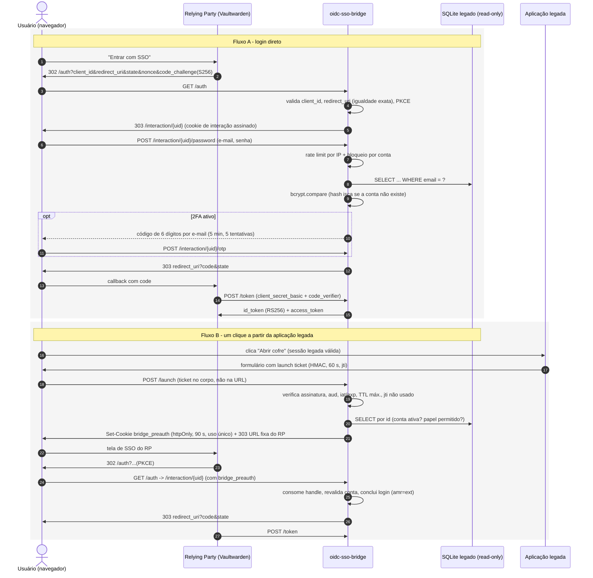

# oidc-sso-bridge

Ponte **OpenID Connect** que autentica usuários de uma **aplicação legada** (base
SQLite própria, sem suporte a SSO) para **qualquer Relying Party OIDC**. O
exemplo de RP é o [Vaultwarden](https://github.com/dani-garcia/vaultwarden)
(cofre de senhas compatível com Bitwarden), mas nada no código é específico
dele.

> Implementação de referência para portfólio. Mostra a técnica e as decisões de
> segurança; não é um produto pronto (ver [Limitações](#limitações)).

## Problema

Uma equipe já tem uma aplicação interna com contas, senhas (bcrypt) e 2FA por
e-mail. Ela adota um serviço novo que fala OIDC (o cofre de senhas) e não quer:

- criar e manter um segundo cadastro de usuários;
- dar acesso de escrita à base legada para um componente novo;
- abrir um caminho de login **mais fraco** que o login original.

A ponte expõe um Authorization Server OIDC padrão (`/.well-known/openid-configuration`,
`/auth`, `/token`, `/jwks`) e usa a base legada **somente para leitura** como
fonte de identidade.

## Dois fluxos de entrada

**A. Login direto pelo RP** — o usuário clica em "Entrar com SSO" no cofre, é
levado à tela da ponte, digita e-mail e senha da aplicação legada e, se o 2FA
estiver ativo, um código enviado por e-mail.

**B. Um clique a partir da aplicação legada** — quem já está logado na aplicação
legada clica em "Abrir cofre". O backend legado emite um *launch ticket*
(HMAC-SHA256, 60 s, uso único) e o envia por `POST` à ponte, que o consome e
deixa um handle opaco de pré-autenticação. Quando o RP inicia o OIDC, a ponte
conclui o login sem pedir senha de novo (a aplicação legada já aplicou senha e
2FA dela).



No caso do Vaultwarden, o SSO prova **identidade**; o cofre continua pedindo a
**senha mestra** para decifrar os dados no cliente (modelo zero-knowledge). Isso
é esperado.

## Estrutura

```
src/
  index.js            bootstrap Express + montagem do oidc-provider
  config.js           leitura/validação de env (falha se faltar segredo ou houver CHANGE_ME)
  oidc.js             clients, PKCE, escopos/claims, política "sempre reautenticar", grant automático
  legacyUsers.js      acesso SOMENTE LEITURA ao SQLite legado + regra de elegibilidade
  credentials.js      bcrypt, hash isca, bloqueio por conta
  emailOtp.js         2º fator por e-mail (HMAC do código, TTL, limite de tentativas)
  launchTicket.js     formato, emissão e consumo do launch ticket (anti-replay)
  preauth.js          handle opaco de pré-autenticação (uso único)
  routes/interaction.js  telas e ações de login
  routes/launch.js       entrada do fluxo de um clique
  logger.js           log JSON com lista branca de campos
  views.js, http.js   HTML escapado, CSP e cabeçalhos de segurança
scripts/
  generate-keys.js    JWKS RS256 + segredos aleatórios
  seed-demo-db.js     SQLite de demonstração com usuários fictícios
  issue-launch-ticket.js  simula a aplicação legada emitindo um tiquete
```

Esquema genérico esperado na base legada:

```sql
users(id INTEGER PK, email TEXT UNIQUE, password_hash TEXT /* bcrypt */,
      display_name TEXT, role TEXT, is_active INTEGER, email_2fa_enabled INTEGER)
```

Para outra base, só `legacyUsers.js` precisa mudar.

## Modelo de ameaças (STRIDE resumido)

| Categoria | Ameaça | Mitigação |
|---|---|---|
| **S**poofing | Força bruta / credential stuffing na tela de login | Rate limit por IP (`express-rate-limit`), bloqueio por conta após 5 falhas em 15 min, 2FA por e-mail opcional ou obrigatório (`REQUIRE_EMAIL_OTP`) |
| **S**poofing | Enumeração de contas | Mensagem única para usuário inexistente e senha errada; bcrypt contra hash isca para igualar o tempo |
| **S**poofing | Segunda pessoa no mesmo navegador herdando a sessão | Política de interação que **sempre** exige login novo, mesmo com sessão OIDC existente |
| **S**poofing | Launch ticket forjado | HMAC-SHA256 com segredo exclusivo, comparação em tempo constante, `aud` obrigatório |
| **T**ampering | Troca de `redirect_uri` para roubar o code | Redirect URIs registradas e comparadas por igualdade exata; omissão não permitida; só `response_type=code` |
| **T**ampering | Interceptação/injeção de authorization code | PKCE S256 obrigatório, code com TTL de 60 s e uso único, autenticação do client no `/token` |
| **R**epudiation | Ausência de trilha de auditoria | Log JSON por evento (login, falha, bloqueio, 2FA, tiquete, emissão de token) com `userId`, IP e id de interação hasheado |
| **I**nformation disclosure | Segredos/PII vazando em log ou URL | Lista branca de campos no logger (sem senha, código, tiquete, e-mail); tiquete por POST; e-mail não vai na URL; páginas com `Cache-Control: no-store` e `Referrer-Policy: no-referrer` |
| **I**nformation disclosure | Erro interno exposto ao navegador | `renderError` e handler de erro genéricos; detalhe só no log |
| **I**nformation disclosure | XSS / clickjacking nas telas de login | Todo conteúdo dinâmico escapado; CSP `default-src 'none'`, `frame-ancestors 'none'`, `X-Frame-Options: DENY` |
| **D**enial of service | Excesso de requisições / payloads grandes | Rate limit, limite de tamanho no corpo dos formulários, tiquete com tamanho máximo |
| **E**levation of privilege | Ponte comprometida alterando a base de identidade | SQLite aberto com `readonly: true` + `PRAGMA query_only`; volume montado `:ro` no compose |
| **E**levation of privilege | Conta desativada ou papel não autorizado obtendo token | `is_active` e `ALLOWED_ROLES` verificados no login, no tiquete, após o 2FA e de novo em `findAccount` |
| **E**levation of privilege | Replay do launch ticket | `jti` registrado ao consumir; TTL máximo de 60 s (teto absoluto 120 s); handle de pré-autenticação de uso único |

Riscos residuais conhecidos: *login CSRF* no `/launch` (um atacante poderia
levar a vítima a entrar com a conta **do atacante**; no Vaultwarden isso é
contido pela senha mestra) e o estado em memória (ver Limitações).

## Como rodar (local)

Requisitos: Node.js 22.12+.

```bash
npm ci
cp .env.example .env
npm run keys        # gera keys/jwks.json e imprime COOKIE_KEYS, RP_CLIENT_SECRET, LAUNCH_TICKET_SECRET -> cole no .env
npm run seed        # cria data/legacy-demo.db com usuários fictícios e imprime as senhas uma vez
npm start
curl http://localhost:3000/.well-known/openid-configuration
```

Com `MAIL_TRANSPORT=console` (somente desenvolvimento) o e-mail com o código
de 2FA é impresso no terminal em vez de enviado.

Fluxo de um clique (com `LAUNCH_ENABLED=true`):

```bash
npm run ticket -- 2   # gera launch-demo.html com um tiquete para o usuário id=2 (vale 60 s)
```

### Com Vaultwarden (docker compose)

Veja os comentários no topo de `docker-compose.yml`. Em resumo: gere chaves e
base, adicione `127.0.0.1 sso-bridge` ao arquivo hosts, ajuste
`OIDC_ISSUER=http://sso-bridge:3000` e `RP_REDIRECT_URIS=http://localhost:8080/identity/connect/oidc-signin`,
então `docker compose up --build`. No Vaultwarden, as variáveis relevantes são
`SSO_ENABLED`, `SSO_AUTHORITY`, `SSO_CLIENT_ID`, `SSO_CLIENT_SECRET`,
`SSO_SCOPES` e `SSO_PKCE`.

## Limitações

- **Estado em memória** (bloqueio por conta, códigos de 2FA, `jti` consumidos,
  handles de pré-autenticação e o adapter padrão do `oidc-provider`): vale
  para **uma** instância e se perde ao reiniciar. Para mais de uma réplica, use
  um adapter persistente (ex.: Redis) e `SET NX` com TTL para o anti-replay.
- O 2FA é por e-mail (fator "algo que você acessa"), mais fraco que TOTP ou
  WebAuthn; está aqui porque espelha o que a aplicação legada já oferece.
- Um único Relying Party configurado; registro dinâmico de clients desligado.
- Sem refresh token, sem logout federado para o RP.
- O laboratório com docker compose roda sem TLS; em produção use proxy reverso
  HTTPS e `NODE_ENV=production` (que passa a exigir `https` e `JWKS_PATH`).
- A senha legada continua sendo verificada aqui; políticas da aplicação legada
  que dependem de escrita (expiração forçada, contador persistente de falhas)
  não são replicadas.

## Licença

[MIT](LICENSE)
